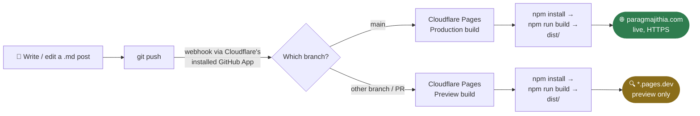

# Deployment Guide: paragmajithia.com

This is a reference for how this blog is actually built and deployed — not a
from-scratch tutorial. Use it to remember how the pieces fit together and how
to publish a new post. For local dev commands and generic project info, see
[README.md](README.md) — this file only covers what's specific to how *this*
site is actually run.

**Live stack:**

- **Framework:** Astro (default `blog` starter template, content collections)
- **Repo:** [github.com/paragmajithia/parag-tech-blogs](https://github.com/paragmajithia/parag-tech-blogs) — public
- **Hosting:** Cloudflare Pages, auto-deployed from GitHub on every push to `main`
- **Domain:** `paragmajithia.com`, bought on Namecheap, DNS + custom domain managed in Cloudflare
- **Cost:** $0/month (domain renewal on Namecheap is the only recurring cost)

---

## 1. How the pieces connect



**The mechanism, concretely:**

1. **The link is a GitHub App, not a personal access token.** When the
   Cloudflare Pages project was first created, Cloudflare's GitHub App
   ("Cloudflare Pages") was installed against the `paragmajithia` GitHub
   account with access to this repo. You can see/manage that install at
   GitHub → **Settings → Applications → Installed GitHub Apps**. This app is
   what lets Cloudflare receive push events — there's no secret key stored in
   this repo to make it work.
2. **Every push triggers a webhook.** GitHub notifies Cloudflare of the new
   commit on `main`. Cloudflare spins up a fresh build container, clones the
   repo at that commit, installs dependencies, and runs the configured
   **build command** (`npm run build`) and publishes whatever's in the
   configured **build output directory** (`dist`, Astro's default).
3. **`main` = production.** The Cloudflare Pages project has `main` set as
   its **production branch** — a push there deploys straight to
   `paragmajithia.com`. Pushing any *other* branch (or opening a PR) instead
   creates a separate **preview deployment** on a `*.pages.dev` URL, without
   touching production — useful for trying a risky change safely.
4. **Where to look if something needs changing:** Cloudflare dashboard →
   **Workers & Pages → (this Pages project) → Settings**. The **Builds &
   deployments** tab holds the build command / output directory / production
   branch; the **Git** section shows the GitHub repo connection and lets you
   disconnect/reconnect it. The **Deployments** tab shows the build log for
   every push, including failures.

There is no manual deploy step. You never log into Cloudflare to publish a
post — only if a build fails, or to change build settings, DNS, or the
domain mapping, which is rare.

---

## 2. Actual folder structure

This project uses Astro's **default blog starter** with content collections
— not a themed template like AstroPaper. The map that matters:

```text
parag-tech-blogs/
│
├── src/
│   ├── content/
│   │   └── blog/                  ← POSTS GO HERE (.md / .mdx)
│   │       ├── gcp-bills-post.md
│   │       ├── markdown-style-guide.md
│   │       └── using-mdx.mdx
│   │
│   ├── content.config.ts          ← frontmatter schema (title, description, pubDate, updatedDate, heroImage, draft)
│   ├── consts.ts                  ← SITE_TITLE, SITE_DESCRIPTION
│   ├── pages/
│   │   ├── index.astro            ← redirects straight to /blog
│   │   ├── about.astro            ← the About page content lives here (not an external link)
│   │   ├── blog/index.astro       ← post listing
│   │   ├── blog/[...slug].astro   ← individual post route
│   │   └── rss.xml.js             ← RSS feed
│   ├── components/                ← Header.astro, Footer.astro, etc.
│   └── assets/                    ← images imported into posts (e.g. src/assets/blog/...)
│
├── public/                        ← static files served as-is (favicon, etc.)
├── astro.config.mjs                ← site config, integrations (mdx, sitemap)
└── package.json
```

**Rule of thumb:**

- Writing a new post? → `src/content/blog/`
- Adding an image for a post? → `src/assets/blog/<post-name>/` and `import` it in the `.md`/`.mdx` frontmatter as `heroImage`, or import inline in `.mdx`
- Changing site title/description? → `src/consts.ts`
- Changing the About page? → `src/pages/about.astro`
- Changing header/nav links? → `src/components/Header.astro`

> Note: the header currently only links to **Blog** and **About** (both
> internal pages), plus GitHub/LinkedIn icons. There is no separate "GCP
> Labs" nav link at the moment — GCP content lives as regular posts in this
> blog instead.

---

## 3. Frontmatter reference

Schema is enforced by `src/content.config.ts`:

```markdown
---
title: 'Stop Surprise GCP Bills with an Automatic Billing Kill Switch'
description: 'Cloud budgets tell you that you''re in trouble. A kill switch does something about it'
pubDate: 'Jun 14 2026'
heroImage: '../../assets/blog/gcp-bills/gcp-bills-hero.png'
---
```

| Field | Required | Notes |
| --- | --- | --- |
| `title` | Yes | String |
| `description` | Yes | String |
| `pubDate` | Yes | Coerced to a `Date` — most human-readable formats work (e.g. `'Jun 14 2026'`), but stay consistent |
| `updatedDate` | No | Same format as `pubDate` |
| `heroImage` | No | Relative path to an image under `src/assets/` — Astro optimizes it via `image()` |
| `draft` | No | `true` = excluded from the blog listing, RSS feed, and doesn't even get a page built at `/blog/<slug>/`. Defaults to `false` |

To work on a post ahead of publishing, add `draft: true` to its frontmatter,
push whenever you like (nothing appears live), then flip it to `false` (or
delete the line) when it's ready.

Embedding video (e.g. YouTube) works via a raw `<iframe>` in the Markdown
body, as done in `gcp-bills-post.md`.

---

## 4. Publishing a new post (your actual weekly workflow)

```bash
# 1. Create the file
#    src/content/blog/my-new-post.md

# 2. Write frontmatter (copy from an existing post) + content

# 3. If it has an image, drop it under src/assets/blog/<post-name>/
#    and reference it as heroImage in frontmatter, or import + <Image />
#    inline for an MDX post

# 4. Preview locally
npm run dev
# open http://localhost:4321/blog

# 5. Ship it
git add .
git commit -m "post: my new post title"
git push
```

Cloudflare picks up the push, builds, and deploys automatically — live in
roughly 60–90 seconds. Check the **Workers & Pages → your project →
Deployments** tab in Cloudflare if you want to watch the build log.

---

## 5. Domain & DNS (already configured — reference only)


- Domain `paragmajithia.com` is registered on **Namecheap**.
- Namecheap's nameservers were pointed to **Cloudflare's** nameservers, so
  Cloudflare is the authoritative DNS for the domain (not Namecheap's DNS
  panel).
- The domain is attached to the Cloudflare Pages project as a **custom
  domain**, which gives free auto-renewing HTTPS.
- You should not need to touch DNS again unless adding something new (e.g. a
  subdomain, an email-sending record like SPF/DKIM if you ever send mail
  from the domain).

If the site ever appears down but the GitHub push succeeded, check in this
order: Cloudflare Pages deployment log → Cloudflare custom domain status →
Namecheap nameserver settings (should still point at Cloudflare).

---

## 6. Local dev

Commands are the same as any Astro project — see README.md's **Commands**
table (`npm install` / `npm run dev` / `npm run build` / `npm run preview`).
Two things worth knowing beyond that table:

- `npm run build` is exactly what Cloudflare runs on every push — if it
  fails locally, it'll fail on Cloudflare too.
- Node.js `>=22.12.0` is required (see `package.json` → `engines`).

---

## 7. Troubleshooting

| Problem | Likely cause | Fix |
| --- | --- | --- |
| Build fails on Cloudflare | Bad frontmatter (missing required field, invalid `pubDate`) | Check the file against the schema in `content.config.ts` |
| Image not showing | Wrong relative path from the `.md` file, or image not under `src/assets/` | Path is relative to the post file, e.g. `../../assets/blog/...` |
| Post not appearing after push | Push didn't land on `main`, or Cloudflare build failed | Check GitHub Actions/commit landed on `main`, then check Cloudflare deployment log |
| Site not loading on `paragmajithia.com` | DNS/nameserver issue | Confirm Namecheap nameservers still point to Cloudflare; check custom domain status in Pages project |
| `npm run dev` fails locally | Node version too old | Needs Node `>=22.12.0` |

---

## 8. Notes for the future

1. **The GitHub repo is the source of truth.** Cloudflare Pages is just a
   build/deploy target — nothing important lives only in Cloudflare.
2. **Backups:** posts are plain Markdown in a public GitHub repo, so they're
   already backed up by git history. No extra step needed.
3. **Cloudflare Pages** has been in maintenance mode (Cloudflare's focus
   shifted to Workers) since 2025, but continues to run reliably for static
   sites. If a migration is ever needed, Astro output is portable to any
   static host (Vercel, Netlify, GitHub Pages) in under an hour.
