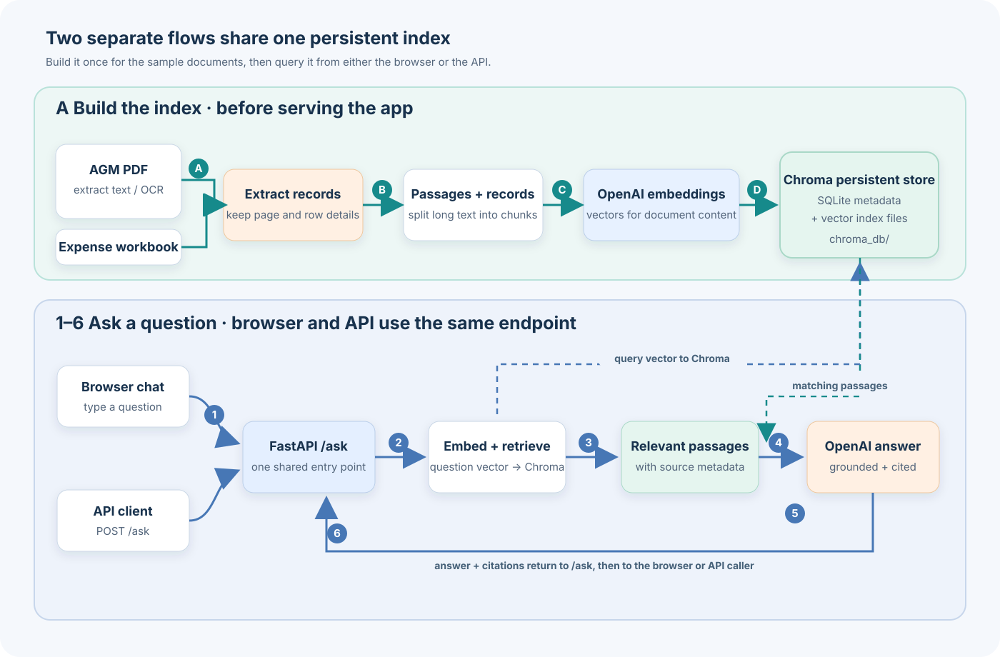

## Two sample documents, one answer grounded in their contents

Retrieval-Augmented Generation (RAG) is easier to understand when you can
follow a question all the way through the system. This small demo uses two
fictional society documents—a meeting agenda and an expense spreadsheet—to
show how document retrieval and an AI-generated answer fit together.

The goal is to make the core RAG flow visible, from preparing documents to
receiving an answer with citations. It is a learning demo, not a production
chatbot.

## Build the index, then ask questions

There are two distinct flows. Before serving the app, ingestion extracts text
from the agenda and records from the workbook, creates passages, generates
document embeddings with OpenAI, and persists them in Chroma.

The browser chat and a direct API request are separate entry points to the same
`/ask` endpoint. For each question, the app creates a question embedding,
retrieves relevant passages from Chroma, and sends those passages with the
question to an OpenAI model. The response includes citations such as a PDF page
or spreadsheet row, so you can inspect the retrieved evidence.

Chroma persists the index in `chroma_db`, using SQLite metadata alongside
vector index files. The app queries Chroma; it does not connect to a separate
business database or run SQL against the workbook.

## Retrieval is useful, not magic

Retrieval grounds the model's answer in the passages found for a question, but
it does not guarantee that the answer is complete or correct. This sample
workbook contains only a few fictional expense rows, for example, so the demo
does not calculate complete financial totals.

The source citations make it easier to verify what was retrieved. That
verification matters: RAG is a way to provide relevant context to a model, not
a substitute for checking important answers.

## Run it locally or deploy to Cloud Run

The [sample RAG project on GitHub](https://github.com/paragmajithia/gcp-labs/tree/main/sample-rag-society)
includes the source documents, Python app, Dockerfile, and setup instructions.
You can build the index locally, use the browser chat or call `/ask` directly,
then deploy the app and generated index to Cloud Run.

Ingestion and live questions make paid API calls. The Cloud Run example is
public and has no authentication, so use only the fictional sample documents,
monitor usage, and clean up the demo resources when finished.
